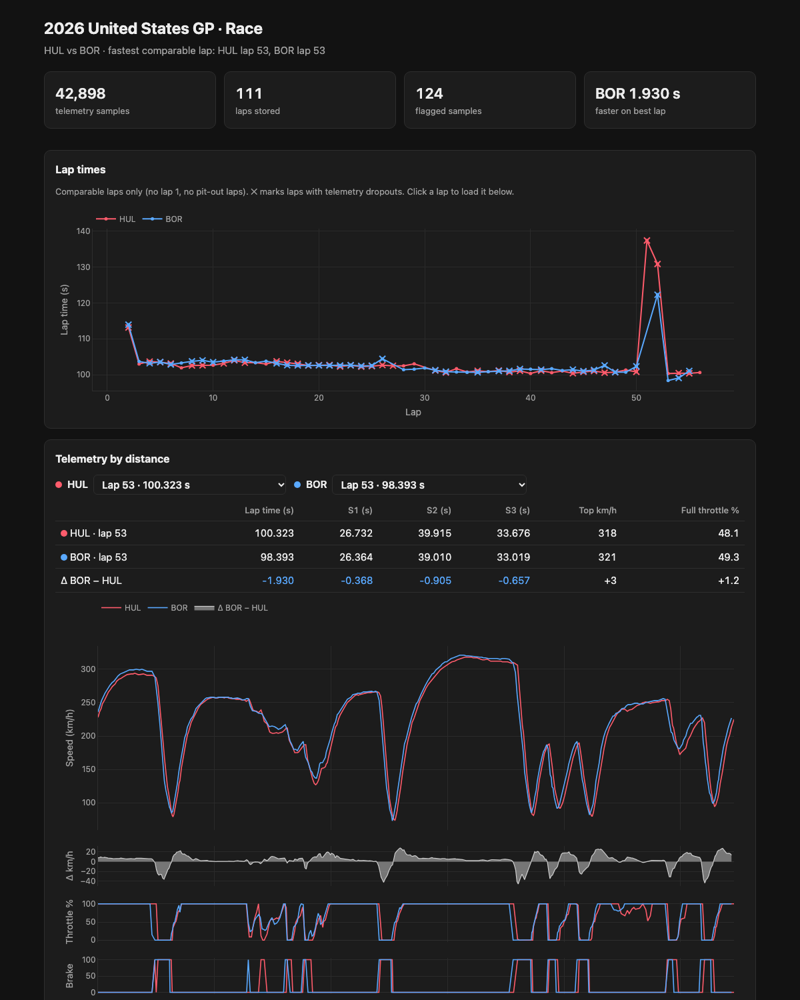

# f1-telemetry

A small Python pipeline for Formula 1 car telemetry. It downloads data for two drivers,
checks it for errors, stores it in SQLite and compares their fastest laps.

**[Open the live report](https://johanstefanes.github.io/f1-telemetry/report.html)**



## How it works

```
OpenF1 API  →  load  →  validate  →  SQLite  →  compare  →  HTML report
```

1. **Load:** car data (speed, RPM, gear, throttle, brake, DRS, ~4 samples per second) and lap times from the free [OpenF1](https://openf1.org) API.
2. **Prepare:** assign every sample to its lap and work out distance from speed.
3. **Validate:** flag missing values, impossible values, timestamps out of order and gaps over 1 s.
4. **Store:** samples, laps and found issues go into `telemetry.db`.
5. **Compare:** fastest comparable lap of each driver, by sector and along the track.

## Run it

You need [uv](https://docs.astral.sh/uv/).

```bash
uv run python -m f1telemetry --year 2026 --location Austin --drivers HUL BOR
uv run python -m f1telemetry.report --title "2026 United States GP · Race"
uv run pytest
```

The first command downloads and stores the data. The second writes `report.html`, which you open in a browser.

## Result: 2026 US GP, Hülkenberg vs Bortoleto (Audi)

- 42,898 telemetry samples over 111 laps, processed in about 7 seconds.
- Bortoleto's best lap was **1.93 s faster** (lap 53), most of it in sector 2.
- 124 samples were flagged, all for gaps over 1 s. The gaps start at exactly the same
  moment in both cars, so the data feed caused them, not the cars' sensors.

| | Lap time | S1 | S2 | S3 | Top speed |
|---|---|---|---|---|---|
| HUL | 100.323 s | 26.732 | 39.915 | 33.676 | 318 km/h |
| BOR | 98.393 s | 26.364 | 39.010 | 33.019 | 321 km/h |

## Built with

Python 3.12, pandas, numpy, SQLite, Plotly. Six pytest tests cover validation, distance, lap comparison and the report.
